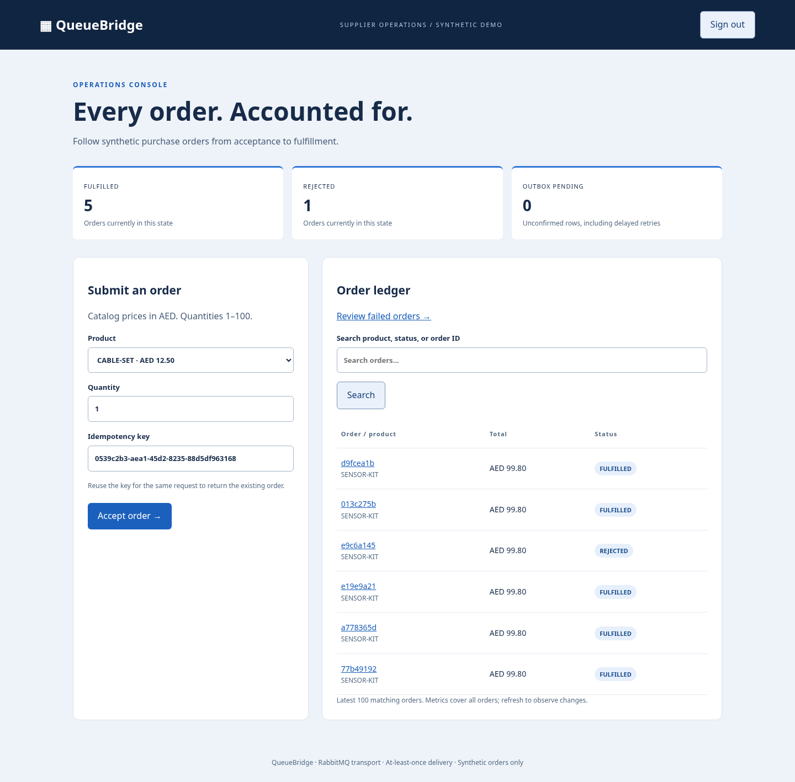

# QueueBridge

A Java 21 portfolio project by Mohamed Said, Computer Science student at Canadian University Dubai. A fictional supplier accepts synthetic orders and processes them through PostgreSQL and RabbitMQ with a transactional outbox and database-backed inbox.

This is a learning project, not production-ready software. RabbitMQ is the implemented broker. The transferable concepts include durable queues, acknowledgments, publisher confirms, duplicate handling, and transaction boundaries. There is no IBM MQ integration or claim of IBM affiliation, employment, certification, or product experience.



Automated repository creation was blocked by GitHub integration permissions. The project is committed and verified locally; see [exact manual publication steps](docs/publication.md).

## Run locally

Requires a full JDK 21, Docker with Compose v2, and OpenSSL. The Maven Wrapper downloads Maven 3.9.11. Ports bind to loopback; PostgreSQL and RabbitMQ are internal to Compose.

```sh
./scripts/init-demo.sh
./mvnw verify
./mvnw package -DskipTests
docker compose up --build -d
```

Open http://localhost:8080. Read the generated `.env` **locally** to obtain the distinct `OPERATOR_PASSWORD` and `ADMIN_PASSWORD`. Usernames are `operator` and `admin`. Never share or commit `.env`. The initializer refuses to replace it. To choose your own credentials, edit this file before starting; both application passwords must differ and have at least 16 characters. Changing database/broker passwords after volume initialization requires changing those services' actual credentials too.

`web` serves the UI/API without consuming or publishing. `worker` runs the same jar without an HTTP server and enables the publisher and consumer. `DEMO_ENABLED=true` is explicitly generated for this local demonstration. Set it to false outside local demos; the server rejects injection actions regardless of browser input. No public deployment is configured.

## What to try

- Submit SENSOR-KIT, RELAY-PACK, or CABLE-SET (AED decimal prices), quantity 1–100.
- Resubmit the same key/content: the same order returns. Different content with that key: HTTP 409.
- Open an order to inspect actual delivery rows, committed processing attempts, and administrative history.
- Stop the worker before selecting a Failure Lab scenario, then restart it. See the [five-minute demo](docs/demo.md).

The authenticated JSON endpoint is `POST /api/orders`, body `{"key":"example-key-123","product":"SENSOR-KIT","quantity":2}`. It uses the same session and CSRF protection as the browser; obtain the CSRF token from an authenticated form. It returns HTTP 200 for both new and repeated submissions. API bodies are bounded to 16 KiB; form bodies are also bounded. No arbitrary queue, command, destination, or event payload is accepted by browser actions.

## Documentation

- [Architecture, state machine, and crash windows](docs/architecture.md)
- [Five-minute demo and broker outage walkthrough](docs/demo.md)
- [Threat model and limitations](docs/security.md)
- [Code-reading guide and interview questions](docs/learning.md)
- [Actual verification results](docs/verification.md)
- [Desktop screenshot](docs/screenshots/desktop.png) · [Mobile screenshot](docs/screenshots/mobile.png)

## Tests and CI

`./mvnw verify` starts real PostgreSQL 17 and RabbitMQ 4.1 Testcontainers. Docker must be accessible. The suite intentionally fails rather than silently skipping container tests when Docker is unavailable. GitHub Actions runs the same Maven verification on Java 21. Tests cover validation, decimal arithmetic, concurrent idempotency, atomic outbox writes, confirms/returns, duplicate delivery, rollback/redelivery, delayed retries, dead letters, replay bounds, authorization, and CSRF.

## Assistance disclosure

Created with substantial OpenAI Codex assistance, including implementation, documentation, and automated verification. Mohamed should review and understand the code before presenting it; the reading guide supports that review. Verification reports distinguish executed checks from design claims. All sample data is synthetic. No payments, real customer data, emails, or external fulfillment calls are used.
