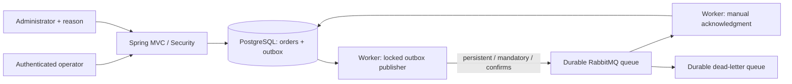
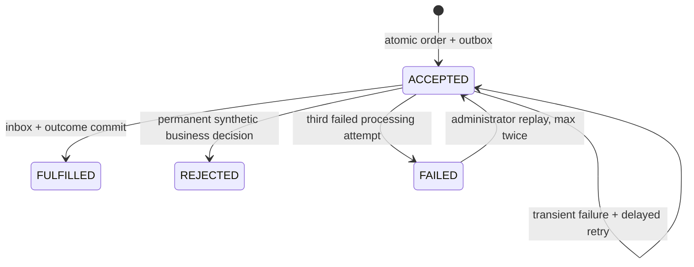

# Architecture and reliability model



```mermaid
sequenceDiagram
 participant O as Operator
 participant W as Web
 participant D as PostgreSQL
 participant P as Publisher
 participant R as RabbitMQ
 participant C as Consumer
 O->>W: order + idempotency key
 W->>D: BEGIN; insert order ON CONFLICT; insert outbox
 D-->>W: COMMIT
 W-->>O: order identity
 P->>D: BEGIN; SELECT outbox FOR UPDATE SKIP LOCKED
 P->>R: persistent event, mandatory routing
 R-->>P: ack confirm and no returned message
 P->>D: mark published; COMMIT
 R->>C: delivery
 C->>D: BEGIN; lock order; inspect inbox; record outcome + attempt
 D-->>C: COMMIT
 C->>R: basicAck
```

## Boundaries and constraints

Orders use UUIDs, NUMERIC(12,2), BigDecimal multiplication, and explicit AED currency. Products and prices are server-controlled. A unique idempotency key serializes racing submissions via `INSERT … ON CONFLICT DO NOTHING`; a committed prior request is compared by product and integer quantity. Whitespace or JSON field ordering do not alter that semantic fingerprint. Keys are case-sensitive and global across operators, matching this single fictional supplier model. There is no multi-tenancy.

The order and its first outbox row share a transaction. An outbox row has its own delivery identity and a stable event UUID. The event schema is version 1: `version`, `eventId`, `orderId`. Unsupported versions, malformed data, and missing orders are rejected to the dead-letter exchange. Events refer to server-stored orders; external payloads cannot set prices or outcomes.

Publisher instances hold row locks with SKIP LOCKED until broker confirmation and the published update commit. This is intentionally simple and holds a DB connection during network I/O. The publisher processes one row per second per worker. A confirm wait is five seconds; connection creation can add the Rabbit client connection timeout. Unconfirmed/nacked/returned publishes stay pending with a five-second delay and a recorded generic error. Publisher retries continue indefinitely during a broker outage; processing retries are bounded. No claim of routing success is based on the send call returning.

Consumer instances lock the order row, inspect the unique inbox event ID, and atomically write the inbox/outcome/attempt. A successful duplicate adds a DUPLICATE observation without another business effect. Failed terminal inbox entries remain dead-letterable on redelivery. STALE observations have no business effect. Acknowledgment or rejection happens **after** TransactionTemplate returns from commit. On infrastructure exceptions the listener closes the channel so unacknowledged deliveries are redelivered after listener recovery (Spring's default recovery interval is five seconds). A prolonged DB outage requires operator intervention; infrastructure delivery attempts are not durably countable while the database itself is unavailable.

## State transitions



Transient simulation fails once per event. Exhaustion fails three times total; retry rows become eligible after 5 then 15 seconds. They reuse the event ID. An administrator replay requires FAILED, a nonblank reason, and at most two replays per order. It emits a **new** event ID and preserves all prior inbox, outbox, attempt, and audit records. Replay clears the synthetic failure scenario to NORMAL for the new event; the original injection audit and failed attempts remain. A business REJECTED order cannot be replayed. Replay does not remove the original message from the DLQ; it creates an audited replacement from the trusted database order, avoiding browser-supplied payloads.

## At-least-once, ordering, and crash windows

- After order commit and before publish: the outbox remains recoverable.
- Broker accepted but publisher lost confirm, or publisher crashed before DB commit: the same event can publish again. The inbox prevents another committed business effect.
- Consumer committed but crashed before ack: RabbitMQ redelivers; inbox detects it.
- Consumer crashed before commit: transaction rolls back; unacknowledged delivery returns.
- Retry transaction committed but ack was lost: duplicate retry rows may be created before a terminal inbox entry exists. Processing failure budgets are checked under the order lock, so terminal business effects remain deduplicated. The 5/15 second delays govern scheduled retry rows; an independent duplicate can arrive earlier.
- Exhaustion committed but rejection was lost: FAILED inbox makes redelivery reject again.
- DLX forwarding on these single-node classic queues is not an independently transactional bridge. Broker failure during dead-letter forwarding can lose a DLQ copy. The FAILED database record and audit trail support replay, but malformed payloads lack database recovery records.

There is no exactly-once delivery guarantee. There are no external side effects: adding real fulfillment would require that downstream system's own idempotency contract. Multiple publishers/consumers and delayed retries do not preserve global FIFO order. Each synthetic order has one fulfillment event and order-row serialization. This is a single-node durable-broker demo, not an HA deployment.

## Metrics

Overview status counts are current database order states across all orders, not event throughput. Pending outbox counts all rows with no confirmed timestamp, including scheduled future retries and duplicates. Publish attempts count database-committed publisher observations; crash attempts can be absent. Timeline attempts are committed consumer observations and can include duplicates/stale deliveries, so they are not unique outcomes. None of these measures RabbitMQ queue depth or end-to-end latency. No fabricated broker health or queue metrics are shown. Each query uses READ COMMITTED, so values can change between queries while a page renders. Compose timestamps render in UTC. Refresh the browser for new observations; the order list shows at most 100 matches.
